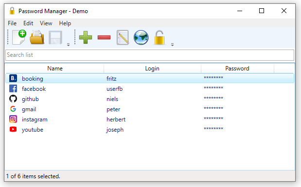
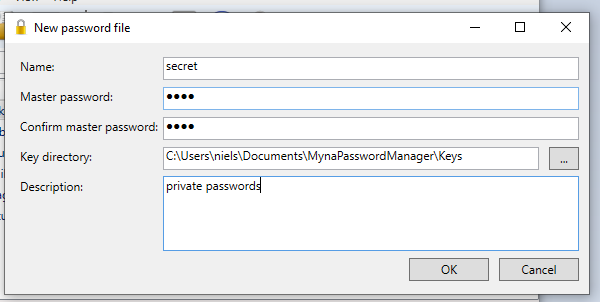
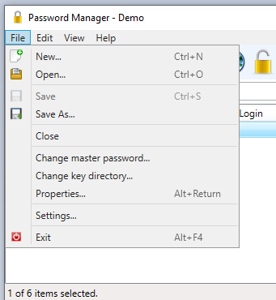
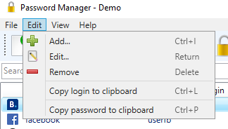
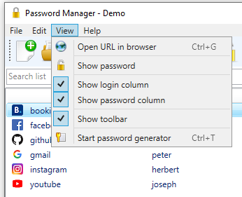
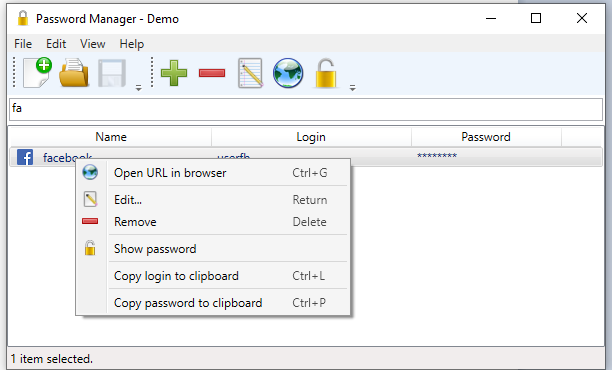
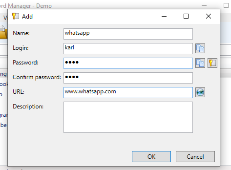
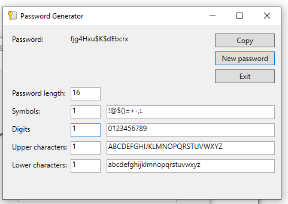
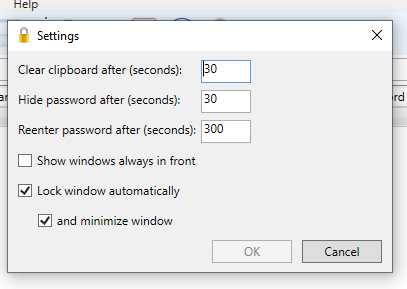

# Myna Password Manager

Myna Password Manager is a Windows desktop application for managing password items in a local, encrypted repository. It is built with .NET and Windows Presentation Foundation (WPF), and is available in English and German.



## Features

- Create, open, search, and edit local password repositories.
- Store login names, passwords, URLs, and descriptions; generate passwords and copy credentials to the clipboard.
- Configure password hiding, clipboard clearing, and idle-lock behavior.
- Import encrypted password backups exported by [TsMynaPortal](https://github.com/nylssoft/TsMynaPortal).
- Optionally upload password items to a compatible [MynaAPIServer](https://github.com/nylssoft/MynaAPIServer) instance.
- Change the repository master password or key directory.

## Installation

1. Install the [.NET 10 Desktop Runtime](https://dotnet.microsoft.com/download/dotnet/10.0) for Windows x64.
2. Download the Windows x64 ZIP from the [releases page](https://github.com/nylssoft/MynaPasswordManager/releases).
3. Extract the archive and run `MynaPasswordManager.exe`.

## Getting started

1. Select **File > New** and provide a repository name, master password, and key directory.
2. Add password items and select **File > Save** to choose a `.pwd` repository file.
3. To open it again, select **File > Open**, choose the repository file, and provide its master password and key directory.

Keep the master password and both repository key files (`.kv2` and `.iv`) safe. The repository file, matching key files, and master password are needed to reopen the repository. Back up the repository and key files securely, preferably on separate devices; losing either the key files or the master password can prevent access to the data.

## Import a web-client password backup

1. Open a local password repository.
2. Select **File > Import web password backup...** and choose the encrypted **ZIP file** exported by TsMynaPortal; do not extract its JSON file.
3. Enter the export passphrase, which must contain at least 12 characters. This is the backup passphrase, not necessarily the local repository's master password.
4. Save the repository to keep the imported items.

The backup is decrypted locally. Items are appended rather than merged or overwritten, so importing the same backup again creates duplicates. The importer accepts the supported password-backup format, up to 16 MiB and 10,000 items.

## Storage and network use

The application encrypts the repository using AES and stores the encrypted repository key and initialization vector in the selected key directory. The master password is used to protect the key. Protect backups and avoid sharing the master password or key files.

Website thumbnails are retrieved from Google's favicon service using the item's domain name, over HTTP, and cached locally. Cloud login and upload contact the configured server; the upload encrypts password data using a separate cloud secret key. Use a trusted HTTPS server and keep the cloud secret key safe. Cloud upload is not a replacement for a secure local backup.

## Build and release

Install the .NET 10 SDK on Windows, then run from the repository root:

```powershell
dotnet build PasswordManager\PasswordManager.csproj --configuration Release
```

To publish a framework-dependent Windows x64 build:

```powershell
dotnet publish PasswordManager\PasswordManager.csproj --configuration Release --runtime win-x64 --no-self-contained
```

The GitHub Actions release workflow publishes a Windows x64 ZIP and creates a GitHub release when a tag matching `v*` is pushed.

## Screenshots

### Create New Repository



### Menu Items

#### File Menu Item



#### Edit Menu Item



#### View Menu Item



#### Context Menu Item and Search Filter



### Add Password Entry



### Password Generator



### Settings



## License and third-party notices

Myna Password Manager is licensed under the GNU General Public License, version 3 or later; see [LICENSE.txt](LICENSE.txt). Third-party software, assets, and services are described in [Third-Party Notices](docs/third-party-notices.md).

